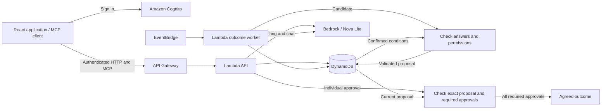

# Known Enough

Known Enough helps groups reach a decision without sharing everyone's private preferences. For a group dinner, participants choose acceptable restaurants and times, review a proposal, and approve it individually. An agreement is recorded only when every required participant approves the same outcome.

**[Open Known Enough](https://known-enough.vercel.app/)** · [Demo guide](https://github.com/Known-Enough/known-enough/blob/development/docs/demo.md)


## Features

- Create a group, invite participants, and define choices manually or with reviewed AI suggestions.
- Save acceptable choices and favourites without showing other participants your answers.
- Review proposals checked against confirmed requirements and permissions you have granted.
- Approve for yourself; AI cannot finalize an agreement or approve for anyone.
- Discuss shared choices in Decision chat; share from Private assistant only after previewing the message.
- Read the current proposal and approvals in a live decision card, then open the outcome for review.

## How it works

For a group dinner, one person accepts Cedar or Maple, another accepts only Maple, and a third accepts Maple or Harbor. The application can propose Maple without publishing anyone's answers or reasons. It remains a proposal until all three approve it individually.


The hosted app requires an approved account. See the [demo guide](https://github.com/Known-Enough/known-enough/blob/development/docs/demo.md) for the participant workflow and access requirements.

## Architecture



The React/Vite frontend uses an AWS backend for authentication, decision state, and AI processing. Amazon Nova Lite suggests options, interprets private notes, and selects candidate outcomes. Server code checks confirmed conditions and permissions before publishing a proposal, then requires individual approvals before recording an agreement. See [architecture](https://github.com/Known-Enough/known-enough/blob/development/docs/architecture.md) for service and source details and [deployment](https://github.com/Known-Enough/known-enough/blob/development/docs/deployment.md) for hosting.

## Alexa+ integration

Decision chat supports questions about shared progress and outcomes. This Alexa+ web simulation uses Bedrock for conversation; its self-hosted MCP server provides four read-only tools for accessible groups, decision lists, progress, and outcomes. The live decision card calls `get_decision_outcome` through MCP and refreshes shared choices and approval counts. Native Alexa+ devices are not connected. See the [MCP guide](https://github.com/Known-Enough/known-enough/blob/development/docs/mcp.md) for the API and a runnable client example.

## Technical implementation

Backend region: `us-east-1`.

| Component | Implementation |
| --- | --- |
| Frontend | React, TypeScript and Vite. Vercel primary hosting; AWS Amplify mirror. Both sites use the same backend. |
| Authentication | Amazon Cognito user pool. In-app SRP sign-in, email confirmation, password recovery and session refresh. API verifies Cognito access tokens; participant identity comes from the signed `sub` claim. |
| Authorization | Application account approval, group membership and organizer permissions are checked separately from authentication. Private reads are scoped to the authenticated owner. |
| API | API Gateway HTTP API and Lambda. Typed request/response schemas, explicit browser origins and authenticated application routes. |
| Storage | DynamoDB partitioned records for accounts, groups, decisions, private answers, chat, approvals and model jobs. Conditional writes and version checks reject conflicting updates. |
| Models | Bedrock Converse with `amazon.nova-lite-v1:0`. Separate adapters for public drafting, private interpretation, candidate outcomes and chat. Structured output is parsed and validated server-side. |
| Background work | EventBridge invokes the Lambda outcome worker. Durable job records track execution, recovery and model usage. |
| Release and diagnostics | S3 stores private runtime packages and recovery artifacts. CloudWatch stores bounded diagnostics and request references. |

Decision rules use typed values and a finite operator set. The validation kernel checks candidates against confirmed conditions and applicable permissions. Final approval is bound to the exact proposal ID, version and public hash. A model response cannot approve a proposal.

The MCP endpoint uses Streamable HTTP, protocol `2025-11-25` and the official TypeScript SDK. Tools: `list_groups`, `list_group_decisions`, `get_decision_progress`, `get_decision_outcome`. Tools are read-only and reuse application access checks. Chat messages use application routes. The live decision card calls `get_decision_outcome` over MCP; card reads do not invoke a model.

## Run the local demo

The hosted application is the full AWS-backed experience. The commands below run a limited local workflow with sample data and simulated AI, without AWS connectivity.

Requires Git, Node.js **24.21.0**, and npm **11.19.0**.

```sh
git clone https://github.com/Known-Enough/known-enough.git
cd known-enough
npm ci
npm run dev
```

In a second terminal, from the repository root:

```sh
PORT=8788 node scripts/run-local-api.mjs
```

Open [http://127.0.0.1:5173](http://127.0.0.1:5173) and select a sample user. Local state is held in memory and clears when the API restarts. See [development setup](https://github.com/Known-Enough/known-enough/blob/development/docs/development.md) for toolchain installation and connected-app configuration, or [contributing](https://github.com/Known-Enough/known-enough/blob/development/CONTRIBUTING.md) for checks.

## Privacy and limits

Known Enough stores your private answers. With your consent, Amazon Bedrock receives private notes and confirmed conditions to interpret answers and generate proposals. Other participants see shared results and disclosures you approve; outcomes can still reveal something about your preferences. Chat sends your recent messages and shared options, excluding saved private answers. Sharing a private chat message requires an explicit preview and post.

The preview supports groups of up to 16 members and finite-choice decisions with at most 64 public combinations. It does not check live availability or make bookings. See [privacy and data handling](https://github.com/Known-Enough/known-enough/blob/development/docs/privacy.md) for processing, retention, and permission details.

## License

[MIT](LICENSE)

## Technical references

Detailed documentation is maintained on `development`. This README is available on both `main` and `development`. Source links below target production code on `main`.

- [Architecture](https://github.com/Known-Enough/known-enough/blob/development/docs/architecture.md) — services, processing and source map.
- [Development setup](https://github.com/Known-Enough/known-enough/blob/development/docs/development.md) — toolchain, local API and connected configuration.
- [Cognito token verification](https://github.com/Known-Enough/known-enough/blob/main/apps/api/src/cognito-identity.ts) · [Sign-in implementation](https://github.com/Known-Enough/known-enough/blob/main/apps/web/src/cognito-direct.ts) — identity and authentication flow.
- [Decision schemas](https://github.com/Known-Enough/known-enough/blob/main/packages/contracts/src/known-enough.ts) · [Group schemas](https://github.com/Known-Enough/known-enough/blob/main/packages/contracts/src/groups.ts) — executable data contracts.
- [Validation kernel](https://github.com/Known-Enough/known-enough/blob/main/packages/domain/src/known-enough-kernel.ts) — rule evaluation, permission checks and proposal validation.
- [Decision persistence](https://github.com/Known-Enough/known-enough/blob/main/packages/adapters/src/partition-decision-repository.ts) — partitioned state and transactions.
- [Bedrock adapters](https://github.com/Known-Enough/known-enough/blob/main/packages/adapters/src/bedrock-models.ts) — model requests and output handling.
- [MCP API](https://github.com/Known-Enough/known-enough/blob/development/docs/mcp.md) — endpoint, authentication, tools and client example.
- [Privacy and retention](https://github.com/Known-Enough/known-enough/blob/development/docs/privacy.md) — processing, visibility, retention and disclosure limits.
- [Deployment](https://github.com/Known-Enough/known-enough/blob/development/docs/deployment.md) · [Infrastructure templates](https://github.com/Known-Enough/known-enough/tree/main/infra/operations) — runtime packages and release configuration.
- [CI workflow](https://github.com/Known-Enough/known-enough/blob/main/.github/workflows/check.yml) — automated check definition.
