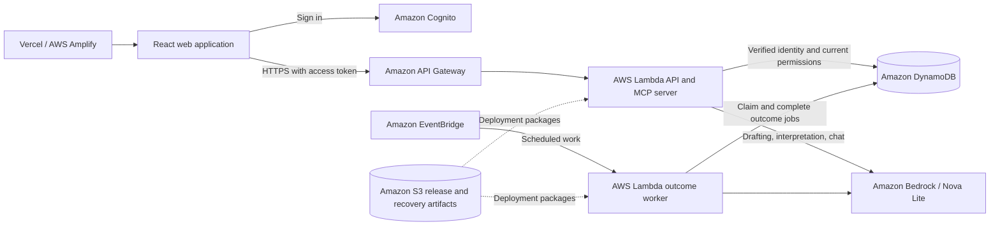

# Known Enough

Known Enough helps groups choose an outcome from shared options while keeping each participant's answers private. Participants save their own choices, review a validated proposal, and approve it individually. An agreement is recorded only after every required participant approves the same proposal.

[Open application](https://known-enough.vercel.app/) · [AWS Amplify mirror](https://main.d143q5ravxp5av.amplifyapp.com/) · [Source repository](https://github.com/Known-Enough/known-enough) · [Submission requirements and feedback](docs/hackathon-submission.md)

## Functionality

- Create groups and invite members by username, verified email, or a recipient-bound link.
- Describe a decision and enter its topics and alternatives manually, or request AI suggestions and review them before use.
- Save acceptable options and optional favourites privately. Optional AI assistance requires processing consent.
- Request an outcome, review any individual permission requests, and approve the exact proposal. Chat cannot save answers or approve on anyone's behalf.
- Use **Decision chat** for shared messages and **Private assistant** for a separate conversation. Sharing private text requires a preview and explicit post.

## Review the hosted application

Use a current desktop or mobile browser. No local installation or AWS credentials are needed.

1. Open the application and sign in with an approved account. New accounts require email verification and application access; judge accounts must be arranged before evaluation.
2. Create a group. Invite a second approved account and accept the invitation from that account's own session. Use separate browser profiles for separate participants.
3. Create a decision with explicit alternatives, for example: restaurant **Cedar / Maple**, date **2026-11-14 / 2026-11-15**, and time **18:00 / 19:00**. Review AI suggestions individually if used.
4. Each participant opens the decision, selects acceptable choices, and saves their own answers. Choose at least one common option per topic for a compatible example.
5. Request an outcome. Each required participant reviews and approves the same proposal. The decision remains proposed until the last required approval.
6. Open **Chat**. In Decision chat, select AI consent and **Post and ask AI** with “What is the outcome and who has approved?” In Private assistant, ask a personal planning question; another participant must not receive that thread. Plain **Post message** does not request AI.

Judge credentials belong in the private submission testing instructions. The access and video items still requiring submission-owner action are listed in the [submission checklist](docs/hackathon-submission.md#submission-checklist).

## Architecture



The backend runs in AWS `us-east-1`. DynamoDB stores accounts, memberships, decisions, private state, chat, and durable job records. The outcome worker uses a one-minute EventBridge schedule; public drafting and chat use bounded API request paths. Bedrock invokes `amazon.nova-lite-v1:0` through Converse. Code validates model output and renders current progress, approval counts, and outcomes from server state. CloudWatch receives bounded operational diagnostics.

| Source | Responsibility |
| --- | --- |
| [apps/web](apps/web) | React/Vite application, Cognito sign-in, decision forms, and chat |
| [apps/api/src](apps/api/src) | Authenticated HTTP, MCP, and model/runtime composition |
| [packages/contracts](packages/contracts) | Strict request, response, and model-output schemas |
| [packages/domain](packages/domain) | Typed rules and proposal validation |
| [packages/application](packages/application) | Decision lifecycle, permissions, approvals, and chat projections |
| [packages/adapters](packages/adapters) | DynamoDB, Cognito, Bedrock, and durable job adapters |
| [scripts/operations](scripts/operations) and [infra/operations](infra/operations) | Runtime packaging, infrastructure, release, and recovery tooling |

## Alexa+ and MCP

The Alexa+ track implementation is a **web simulation**, with a self-hosted MCP server. It is not connected to a native Alexa+ device or the gated Amazon developer console. This review path is described in the [official hackathon FAQ](https://amazonappdev2026.devpost.com/details/faqs).

The [MCP server](apps/api/src/mcp-server.ts) uses the official TypeScript SDK and Streamable HTTP, protocol `2025-11-25`, at [`/mcp`](https://u94iyvt6p9.execute-api.us-east-1.amazonaws.com/mcp). Every request requires a valid approved participant token and current resource access. An unauthenticated browser visit returns `401`; authenticated GET returns `405` because server notifications are disabled.

| Read-only tool | Arguments | Result |
| --- | --- | --- |
| `list_groups` | Optional `cursor` | Accessible group IDs and names |
| `list_group_decisions` | `groupId` | Accessible decision IDs and titles |
| `get_decision_progress` | `decisionId` | Shared answer and approval status |
| `get_decision_outcome` | `decisionId` | Current shared proposal or agreed choices |

In the [web simulator](apps/web/src/alexa-chat.tsx), **About the assistant** performs MCP initialization and tool discovery. Saved conversations use authenticated chat routes and Bedrock; they do not route every message through MCP tools. A compatible MCP client can invoke the four tools directly.

To exercise the complete MCP exchange, supply your own Cognito participant access token as `KE_ACCESS_TOKEN` in a private shell, then run:

```sh
mcp_request() {
  curl --fail-with-body --silent --show-error \
    https://u94iyvt6p9.execute-api.us-east-1.amazonaws.com/mcp \
    -H "Authorization: Bearer ${KE_ACCESS_TOKEN:?Set your participant access token}" \
    -H 'Content-Type: application/json' \
    -H 'Accept: application/json, text/event-stream' \
    -H 'MCP-Protocol-Version: 2025-11-25' \
    --data "$1"
}
mcp_request '{"jsonrpc":"2.0","id":1,"method":"initialize","params":{"protocolVersion":"2025-11-25","capabilities":{},"clientInfo":{"name":"review-client","version":"1.0.0"}}}'
mcp_request '{"jsonrpc":"2.0","method":"notifications/initialized"}'
mcp_request '{"jsonrpc":"2.0","id":2,"method":"tools/list","params":{}}'
mcp_request '{"jsonrpc":"2.0","id":3,"method":"tools/call","params":{"name":"list_groups","arguments":{}}}'
unset KE_ACCESS_TOKEN
```

This server is stateless and does not require a session ID between requests. The example performs shared reads and makes no model calls.

## Install and run locally

Requirements: Git, Node.js **24.21.0**, npm **11.19.0**, a current browser, and network access to install dependencies. The exact Node/npm versions are enforced by the repository. The commands below use Bash on Linux, macOS, or Windows with WSL; `nvm` is optional if the pinned versions are already installed.

```sh
git clone https://github.com/Known-Enough/known-enough.git
cd known-enough
nvm install
nvm use
npm install --global npm@11.19.0
npm ci
npm run dev
```

In a second terminal, from the repository root with the same Node version:

```sh
PORT=8788 node scripts/run-local-api.mjs
```

Open [http://127.0.0.1:5173](http://127.0.0.1:5173). With the six connected-app settings below unset, this runs the retained local Christmas/TeamTable fixtures. Select a fictional test user, such as Maya or Leo. The API must report port **8788** to match this UI; its standalone default is 8787.

Local fixtures use in-memory storage, fictional sessions, and injected model responses. They demonstrate local decision behaviour; current group management, durable chat, real Cognito authentication, and live Bedrock require the connected application. No AWS account, model key, or email is needed for the fixtures. Restarting the API clears their state. Stop both processes with Ctrl+C. See the [local account guide](docs/ke11-local-test-auth.md) for fixture invitations and session handling.

### Configure the connected application

For an operator-provided backend, copy the environment template and replace all six values with that installation's public configuration:

```sh
cp apps/web/.env.example apps/web/.env.local
```

| Variable | Required value |
| --- | --- |
| `VITE_COGNITO_REGION` | Cognito region, currently `us-east-1` |
| `VITE_COGNITO_USER_POOL_ID` | User pool ID |
| `VITE_COGNITO_DOMAIN` | Cognito hosted domain, including `https://` |
| `VITE_COGNITO_PARTICIPANT_CLIENT_ID` | Public participant app-client ID |
| `VITE_COGNITO_DISPLAY_CLIENT_ID` | Separate public display app-client ID |
| `VITE_API_BASE_URL` | HTTPS API base URL, without `/mcp` |

Vite reads these values at startup/build time. They are browser configuration, not secrets. AWS credentials, client secrets, private runtime packages, and participant tokens must remain outside the web build.

Before using another origin, the operator must configure its exact API/MCP CORS origin and any Cognito callback/logout URLs used by that sign-in flow. The current hosted API allows the two published application origins; a localhost frontend is not automatically authorized.

For the complete cloud deployment, operators need AWS CLI v2, Python 3, AWS resource/IAM access, Bedrock Nova Lite access, Cognito clients, API Gateway/Lambda, DynamoDB storage, and the model-job control/retention configuration. The [API initializer](scripts/operations/partition-entry.ts), [worker initializer](scripts/operations/jobs-runtime-entry.ts), [infrastructure templates](infra/operations), and [coordinated release workflow](.github/workflows/operations-jobs-api-release.yml) define the installed composition. Private signing keys and resource manifests are generated and retained by the operator. This tooling targets the existing AWS installation; another account requires adapting its account/resource guards and provisioning new private configuration. It is not a general-purpose fresh-account installer.

### Build and checks

For a connected production build, configure all six variables first:

```sh
npm run build
npm run preview --workspace @deal-table/web -- --port 4173
```

The build output is `apps/web/dist`; preview is [http://127.0.0.1:4173](http://127.0.0.1:4173). A production build without valid connected configuration displays an unavailable page. The local fixture is available through the development server.

Available checks:

```sh
npm run check:references
npm run lint
npm run typecheck
npm test
npx playwright install chromium
npm run check
```

`npm run check` includes reference/planning checks, lint, types, unit/integration tests, builds, bundle privacy checks, and browser tests. Minimal Linux installations may need `npx playwright install --with-deps chromium`; browser checks use port 4173. Existing full-suite failures are documented in the dated [ALX02 report](docs/review-artifacts/ALX02/report.md). The [E2E04 report](docs/review-artifacts/E2E04/20261020T162508Z/report.md) records six qualified cases across execution and targeted follow-up, rather than a fresh full-suite run.

## Privacy and limits

Private answers are processed by Known Enough and its permitted AI service when consent is given. Other participants receive shared facts and explicitly authorized disclosures; outcomes and timing can still allow inference. Chat AI receives the sender's bounded recent conversation and shared options, excluding other participants' messages, other private threads, and saved private answers. Chat persists for up to 30 days, shortened by retention settings or decision deletion.

The preview supports bounded finite-choice decisions and groups of up to 16 members. Ambiguous or unsupported conditions require clarification. Unknown save/model outcomes require status checks rather than automatic replay. The application does not make bookings, purchases, or external arrangements.

## Hackathon materials

The documented submission path is **Alexa+**, with AWS integration evidence for **AWS Builder**. See the [requirements checklist, service feedback, and remaining submission items](docs/hackathon-submission.md). Repository history begins on September 19, 2026, within the submission period; the implementation evolved from TeamTable into the current application during that period.

**Demo video:** not yet recorded. The public YouTube or Vimeo link will be added when available.

## License

[MIT](LICENSE). Third-party dependencies retain their respective licenses.
