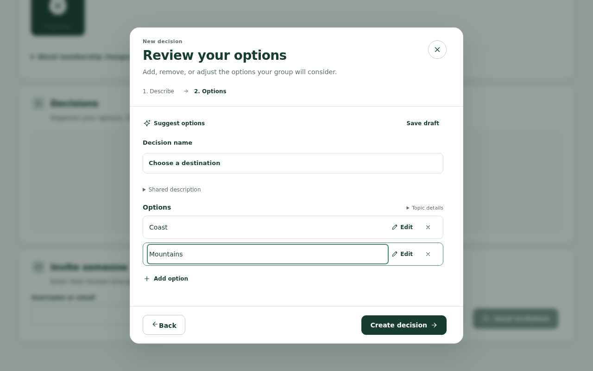
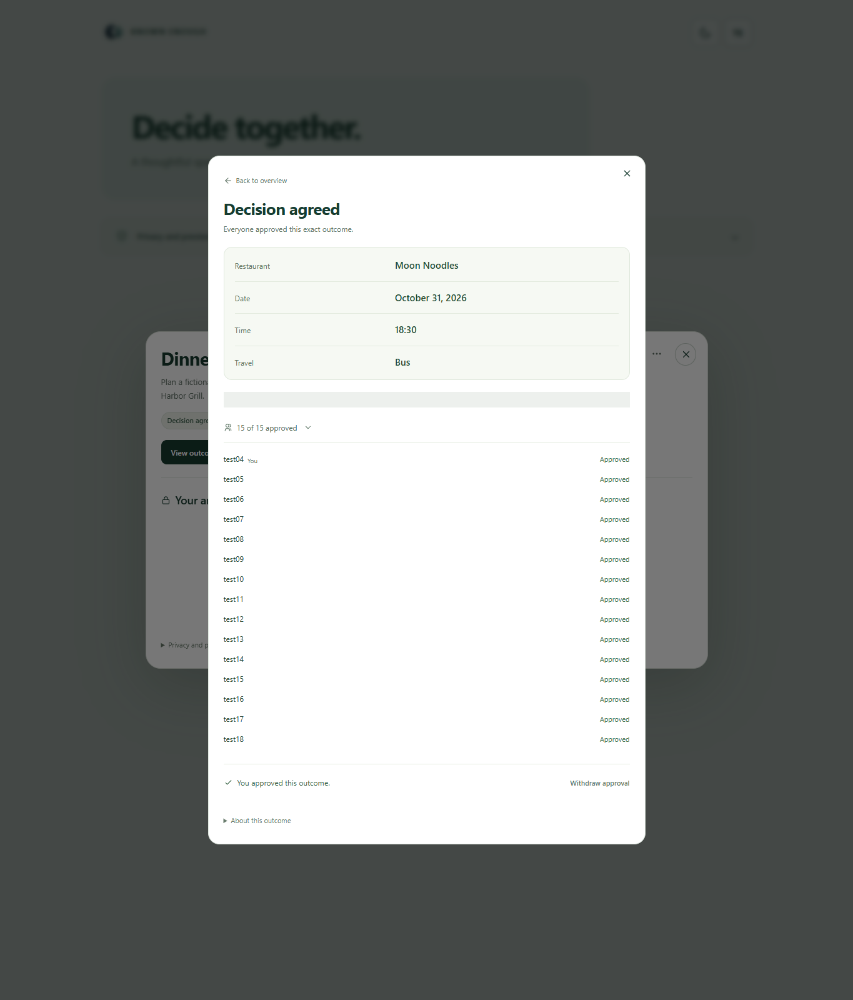
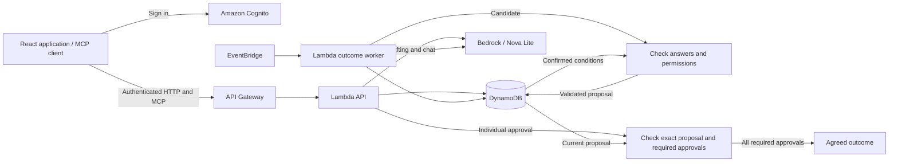

# Known Enough

Known Enough helps groups reach a decision without sharing everyone's private preferences. For a group dinner, participants choose acceptable restaurants and times, review a proposal, and approve it individually. An agreement is recorded only when every required participant approves the same outcome.

**[Open Known Enough](https://known-enough.vercel.app/)** · [Demo guide](docs/demo.md)



## Features

- Create a group, invite participants, and define choices manually or with reviewed AI suggestions.
- Save acceptable choices and favourites without showing other participants your answers.
- Review proposals checked against confirmed requirements and permissions you have granted.
- Approve for yourself; AI cannot finalize an agreement or approve for anyone.
- Discuss shared choices in Decision chat; share from Private assistant only after previewing the message.

## How it works

For a group dinner, one person accepts Cedar or Maple, another accepts only Maple, and a third accepts Maple or Harbor. The application can propose Maple without publishing anyone's answers or reasons. It remains a proposal until all three approve it individually.



The hosted app requires an approved account. See the [demo guide](docs/demo.md) for the participant workflow and access requirements.

## Architecture



The React/Vite frontend uses an AWS backend for authentication, decision state, and AI processing. Amazon Nova Lite suggests options, interprets private notes, and selects candidate outcomes. Server code checks confirmed conditions and permissions before publishing a proposal, then requires individual approvals before recording an agreement. See [architecture](docs/architecture.md) for service and source details and [deployment](docs/deployment.md) for hosting.

## Alexa+ integration

Ask “Who still needs to answer?” or “What did we agree on?” in Decision chat to get current shared progress and results. This Alexa+ web simulation uses Bedrock for conversation; its self-hosted MCP server provides four read-only tools for accessible groups, decision lists, progress, and outcomes. Native Alexa+ devices are not connected. See the [MCP guide](docs/mcp.md) for the API and a runnable client example.

## Run the local demo

The hosted application is the full AWS-backed experience. The commands below run a limited local workflow with sample data and simulated AI, without AWS connectivity.

Requires Git, Node.js **24.21.0**, and npm **11.19.0**.

```sh
git clone https://github.com/Known-Enough/known-enough.git
cd known-enough
npm ci
npm run dev
```

In a second terminal, from the repository root:

```sh
PORT=8788 node scripts/run-local-api.mjs
```

Open [http://127.0.0.1:5173](http://127.0.0.1:5173) and select a sample user. Local state is held in memory and clears when the API restarts. See [development setup](docs/development.md) for toolchain installation and connected-app configuration, or [contributing](CONTRIBUTING.md) for checks.

## Privacy and limits

Known Enough stores your private answers. With your consent, Amazon Bedrock receives private notes and confirmed conditions to interpret answers and generate proposals. Other participants see shared results and disclosures you approve; outcomes can still reveal something about your preferences. Chat sends your recent messages and shared options, excluding saved private answers. Sharing a private chat message requires an explicit preview and post.

The preview supports finite-choice decisions and groups of up to 16 members. It does not check live availability or make bookings. See [privacy and data handling](docs/privacy.md) for processing, retention, and permission details.

## License

[MIT](LICENSE)
