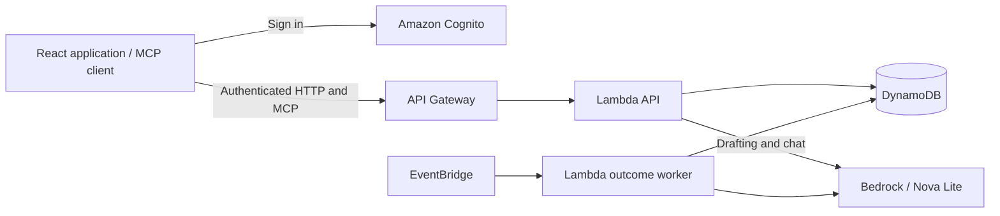

# Known Enough

Known Enough helps groups reach a decision without sharing everyone's private preferences. Participants choose acceptable options, review a proposal, and approve it individually. An agreement is recorded only when every required participant approves the same outcome.

**[Open Known Enough](https://known-enough.vercel.app/)** · [Demo guide](docs/demo.md)


## Features

- Create a group and invite participants.
- Define decision topics and options manually or with AI suggestions.
- Save acceptable choices and favourites privately.
- Review a proposed outcome and collect individual approvals.
- Discuss shared choices in Decision chat or explore preferences with Private assistant.

## How it works

An organizer defines the choices the group needs to make. Each participant saves their own answers. The application checks a proposed outcome against those answers, then asks each required participant to approve it. AI helps structure decisions and explain options; the application controls permissions and records approvals.

The hosted app requires an approved account. See the [demo guide](docs/demo.md) for the participant workflow and access requirements.

## Architecture



The React/Vite frontend uses an AWS backend for authentication, decision state, and AI processing. Amazon Nova Lite assists with suggestions and reasoning; server code validates proposals and supplies current decision facts. See [architecture](docs/architecture.md) for service and source details.

## Alexa+ integration

The Alexa+ experience is a web simulation, with a self-hosted MCP server. Its four read-only tools expose accessible groups, decision lists, progress, and outcomes. Chat uses Bedrock; the browser's MCP connection check initializes the server and discovers its tools. The project does not connect to native Alexa+ devices. See the [MCP guide](docs/mcp.md) for the API and a runnable client example.

## Run the local demo

Requires Git, Node.js **24.21.0**, and npm **11.19.0**.

```sh
git clone https://github.com/Known-Enough/known-enough.git
cd known-enough
npm ci
npm run dev
```

In a second terminal, from the repository root:

```sh
PORT=8788 node scripts/run-local-api.mjs
```

Open [http://127.0.0.1:5173](http://127.0.0.1:5173) and select a sample user. The local demo uses sample data, in-memory storage, and simulated AI; the full group and chat features use the hosted service. See [development setup](docs/development.md) for toolchain installation and connected-app configuration.

## Privacy and limits

Private answers are processed by Known Enough and its permitted AI service with consent. Other participants receive shared facts and explicitly authorized disclosures; outcomes may still allow inference. Sharing a private chat message requires an explicit preview and post.

The preview supports finite-choice decisions and groups of up to 16 members. Unsupported conditions require clarification. See [privacy and data handling](docs/privacy.md) for processing, retention, and permission details.

## Development documentation

- [Contributing and checks](CONTRIBUTING.md)
- [MCP API](docs/mcp.md)
- [Deployment](docs/deployment.md)

## License

[MIT](LICENSE)
