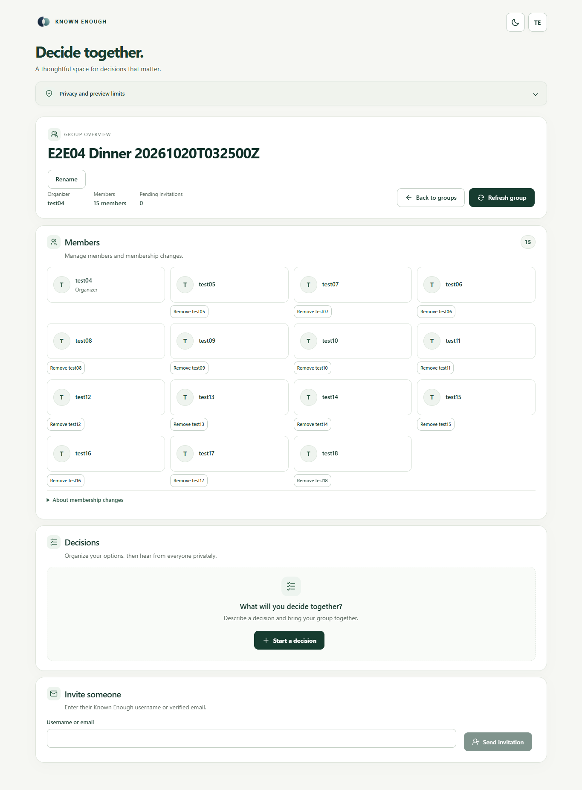
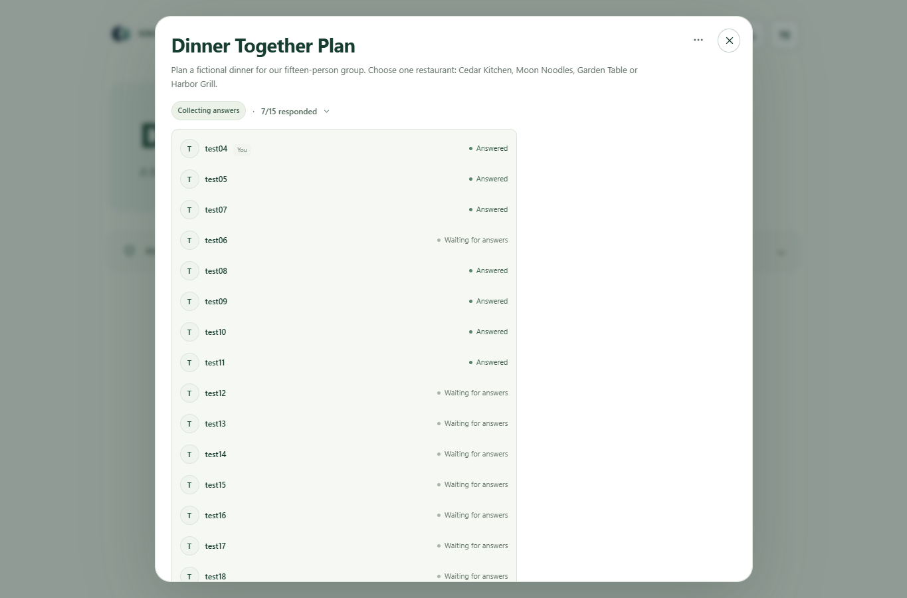
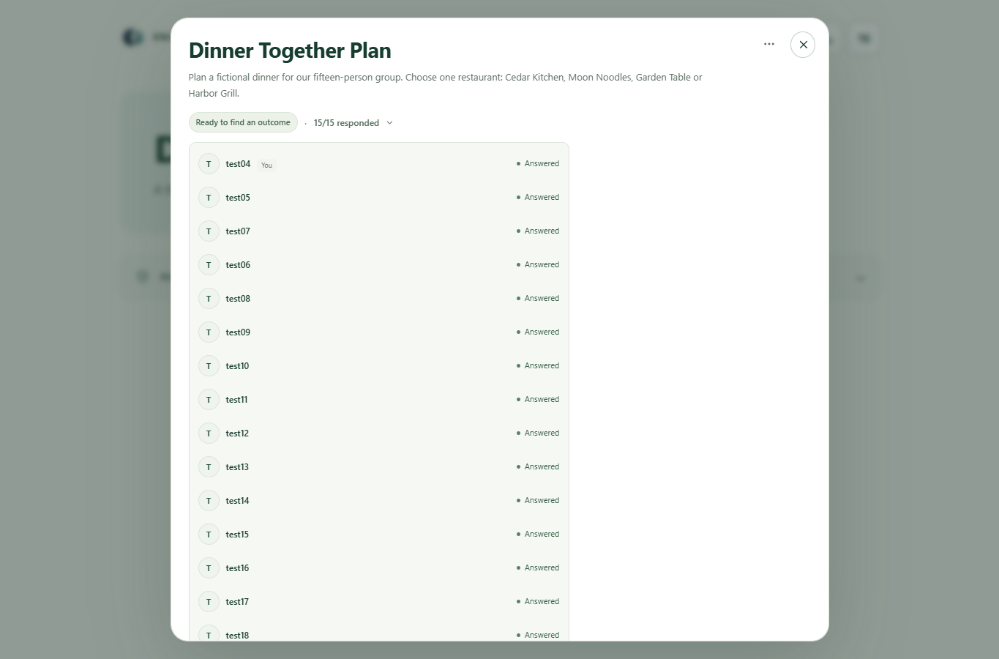
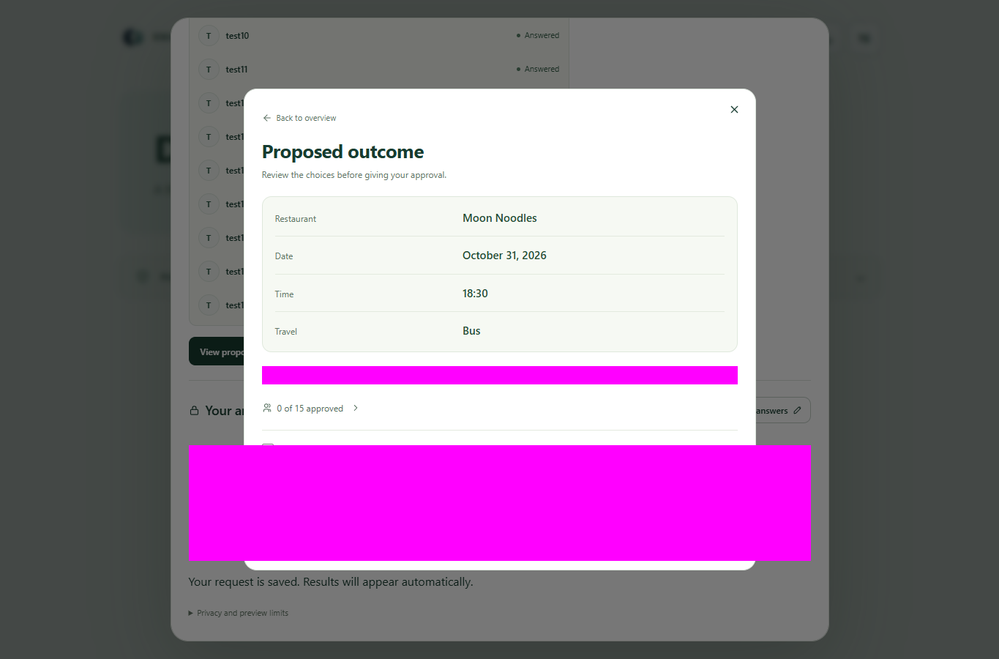
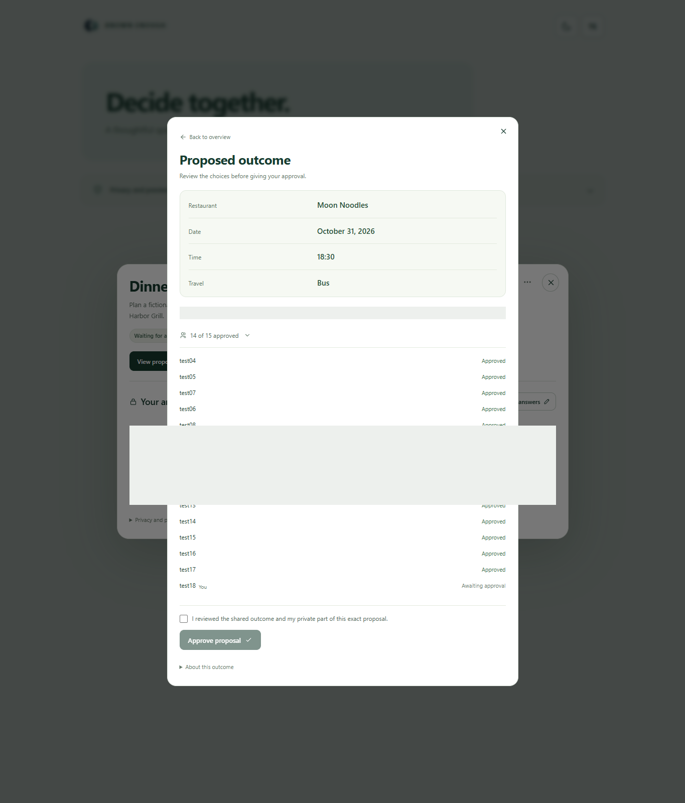
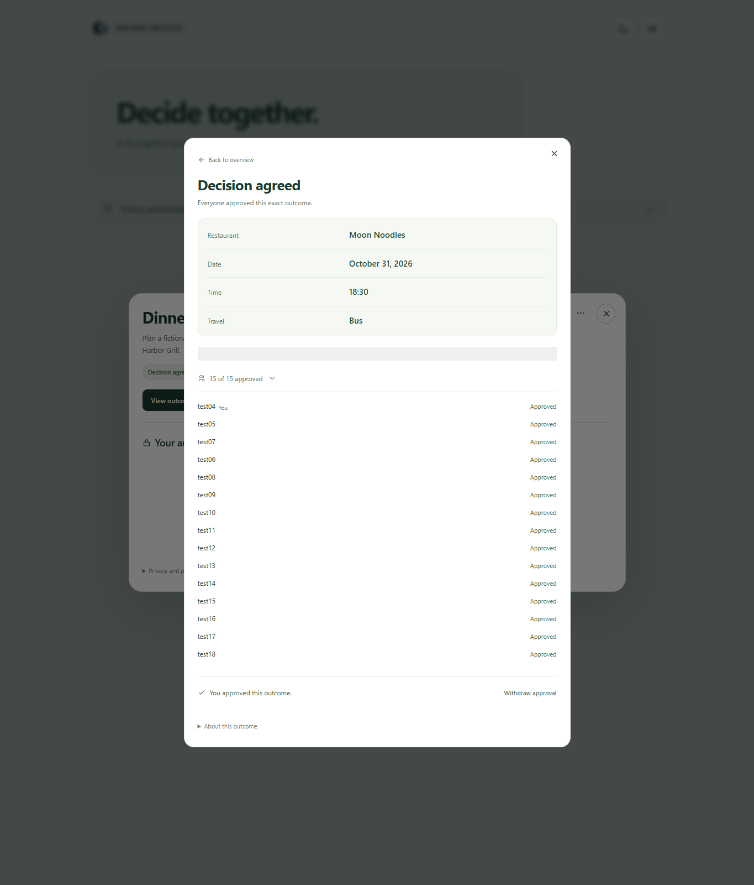
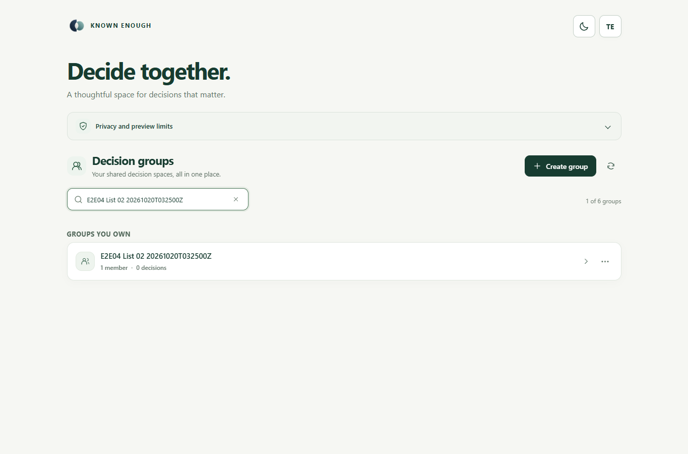
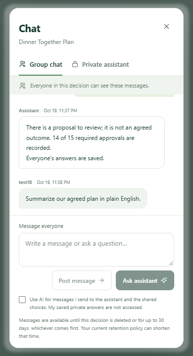

# E2E04 — completed with failures

**FAIL — four cases passed, two failed.** The retained dinner decision is **AGREED**, with fifteen distinct saved answers and fifteen explicit approvals of the same proposal. U01/U08/U15 reopened it with unchanged own choices.

UTC 2026-10-20T03:23:37.850Z → 2026-10-20T05:41:23.350Z, including a user pause. Node24.19.0 under the explicit runtime override; Playwright1.63.0 / Chrome155. Fifteen isolated sessions, one open page. Source `1f7d441`; frontend152/public HTML and API ZIP `e8338c82` matched final readbacks. Worker `c4258495` is dated baseline evidence. [Sources](serving-final-api.json), [frontend](serving-final-frontend.json).

| Case | Result | Observation |
| --- | --- | --- |
| 01 Members | PASS | Fifteen distinct users; one organizer; fourteen accepted invitations. |
| 02 Pagination/lists | PASS | Six owned groups; real pages 5+1; search/clear/no-match, themes, chips, scrolling and close controls. |
| 03 Answers/messages | FAIL | Three initial saves503; reconciled before recovery. Eventually15 exact own answers and15 correctly authored posts; no duplicates. |
| 04 Outcome/speed | PASS | One request; exact tuple visible in **9.532s**; initially0/15 approvals. |
| 05 Approvals | PASS | Fifteen distinct approvals;14/15 remained unagreed; final three-user readback15/15. |
| 06 Assistant/privacy | FAIL | Six answers; two summary requests UNAVAILABLE without replies. Privacy/persistence passed. |

**Plan:** Moon Noodles ·31 October2026 ·18:30 ·Bus. Outcome provider/deterministic execution, provider-call count, tokens and billed cost remain **UNKNOWN**. UI requests: one draft, one outcome, eight assistant questions; fifteen plain posts requested no AI. Eighteen answer-save attempts produced fifteen acknowledgments; all fifteen approvals succeeded once.

The one AI draft preserved twelve options but required exact topic-label normalization: drafting criterion **FAIL**, with semantic alternatives preserved. Recorder interruptions, expiry and selector failures were reconciled; no unknown app write remains. No product/infrastructure fix or deployment occurred.

### Assistant: expected → observed

| Check | Observed |
| --- | --- |
| Seven answers → eight outstanding | Correct eight names. |
| Umbrella → definition | Relevant rain/sun definition. |
| Arrival → two practical suggestions | Group chat or shared calendar. |
| Proposal → tuple/15 approvals remaining | UNAVAILABLE; no reply. |
| Fourteen approvals → not agreed | Correct14/15 and explicit not agreed. |
| Agreed plan → final summary | UNAVAILABLE; no reply. |
| Private support → useful/private | Relevant; persisted only in U15’s thread. |
| Other owner’s private data → refusal | Refused; no private content disclosed. |

Original failed replies were checked read-only, never resubmitted. Group27 messages retained timestamps across U01/U15; U01’s private thread stayed empty. [Assessment](assistant-assessment.json).

Retained: main group `E2E04 Dinner 20261020T032500Z`, **Dinner Together Plan**, two saved drafts and five empty pagination groups. Exact IDs/auth state remain private. Claim released. Next: diagnose the save503s and failed summary receipts; review the strict label criterion. [Precise follow-ups](followups.md), [completion](completion.json), [summary](summary.json), [events](events.jsonl).

## Gallery

All light theme; private sections hidden/masked. Click an image to inspect it. Tall approval captures preserve readable rows. Older diagnostic captures remain as historical evidence outside this main gallery.

### Fifteen members — 1365×900, full page

### Seven answers — 1365×900

### Fifteen answers, no approvals — 1365×900

### Exact proposal, zero approvals — 1365×900

### Fourteen approvals, not agreed — 1365×1600; some rows masked

### Agreed plan, all fifteen approvals — 1365×1600

### Later-page search — 1365×900

### Mobile chat and reachable controls — 390×720

