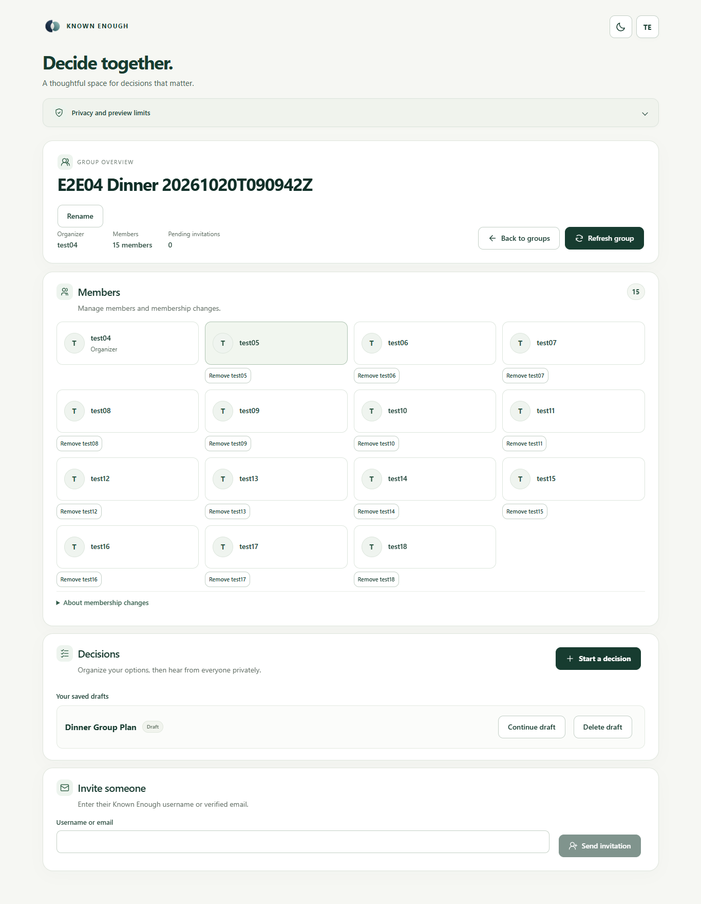
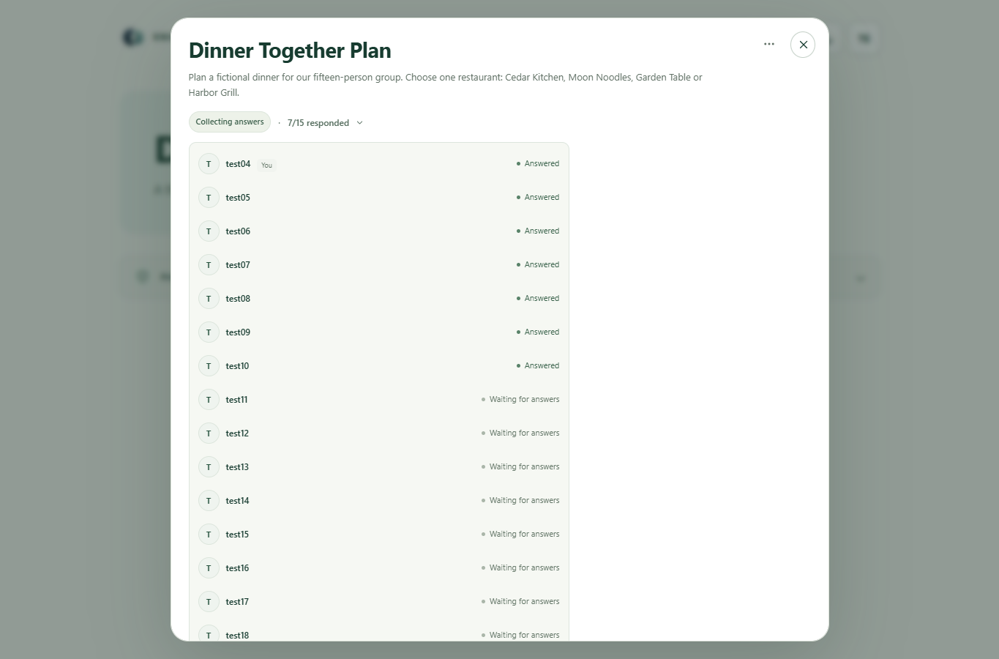
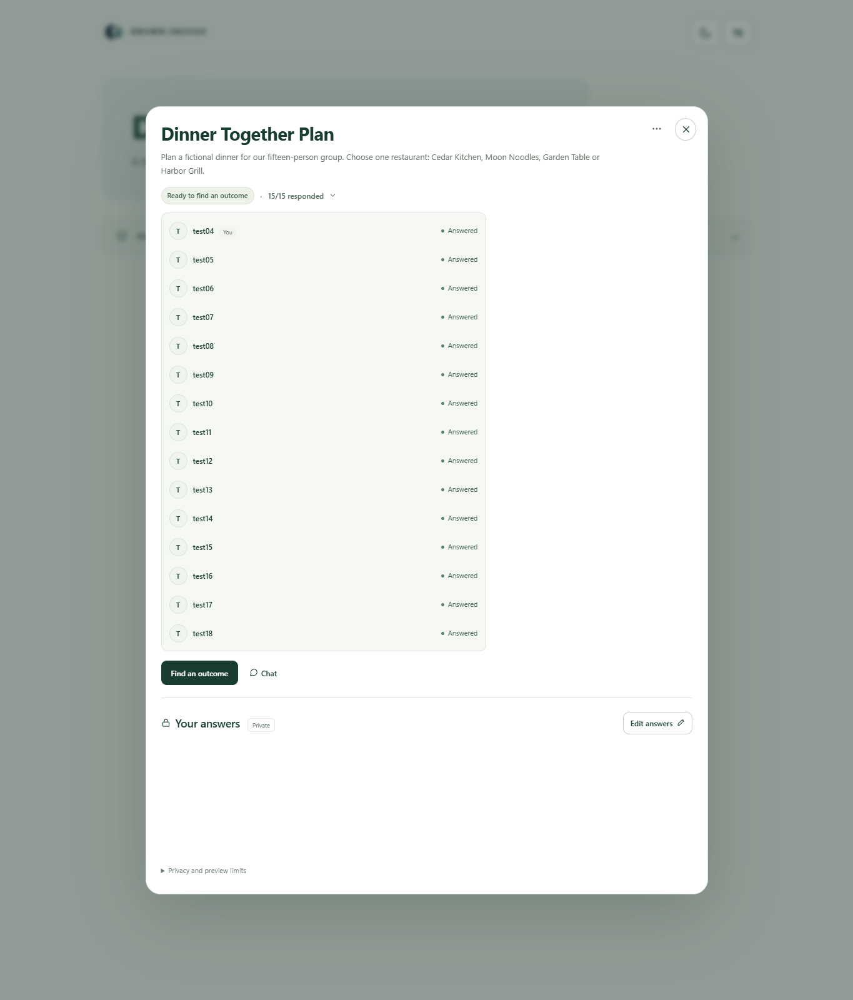
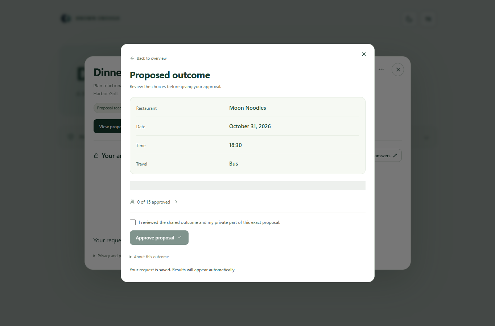
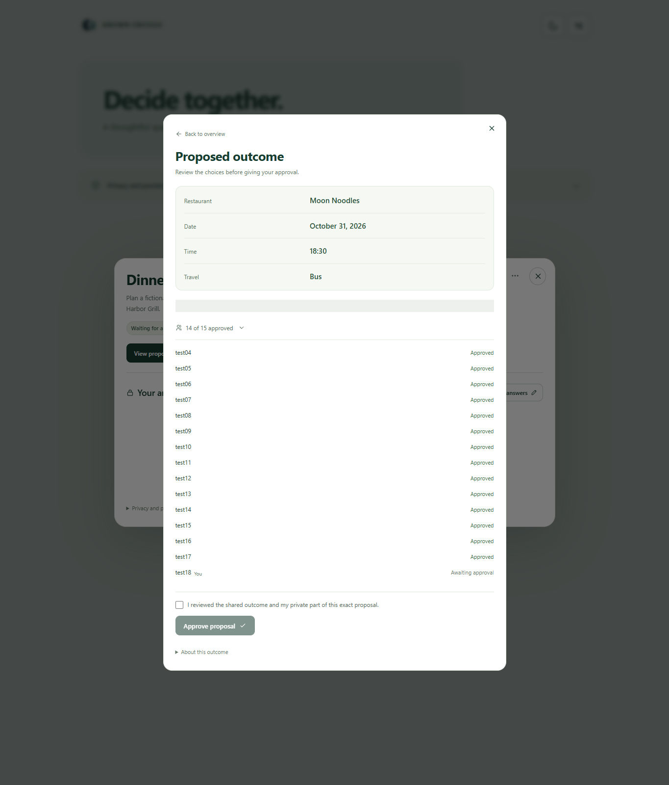
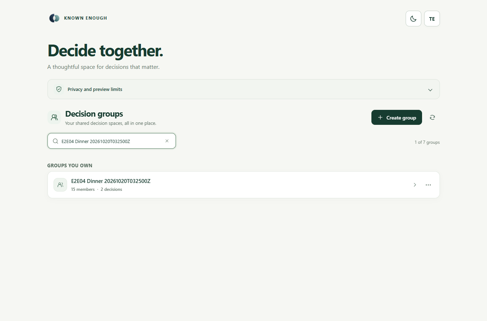
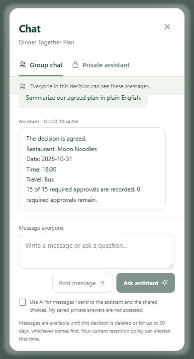

# E2E04 repair qualification — PASS

All **six cases qualify across the executed fifteen-user run and the targeted renderer follow-up**. This is combined dated evidence, not a fresh full six-case run on one source. The browser closed normally after PASS at2026-10-20T16:36:30Z. Node24.19.0, project Playwright1.63, Chrome155; fifteen isolated identities, one active page.

[Execution stage](../20261020T161058Z/report.md) used backend86341eb9. Final targeted stage used0006a4d3/API9488da66/worker97748a77; frontend remains Amplify152/source1f7d441. [Publication](../repair-20261020/render-publication.json) and [restored ENABLED schedule](../repair-20261020/render-schedule-restore.json). No IAM/resources/accounts were added. Prior agreed and failed fixtures remain intact.

| Case | Result | Actual evidence |
| --- | --- | --- |
|01 Members/invitations | PASS |14 own-account acceptances;15 distinct members, one organizer, no pending invitations; fresh authentication/roster/layout reconfirmed. |
|02 Pagination/search/lists | PASS |Seven unique groups fetched as5+2; later-page search, X clear/no-match, light/dark, hover/chips/menu and mobile350px search passed. All15 activity/approval rows and close controls reachable. |
|03 Private answers/messages | PASS |15 first-attempt saves200; all own CSV selections matched, no flashing recovery panel.15 posts/15 correct authors persist from U01/U15, no duplicates or timestamp changes. |
|04 Compatible outcome/speed | PASS |One request,22.142s click-to-visible; Moon Noodles ·2026-10-31 ·18:30 ·Bus; initial0/15 approvals. |
|05 Independent approvals | PASS |15 explicit owner approvals200 of one pinned proposal; U15 last.14/15 remained unagreed; fresh U01/U08/U15 show AGREED,15/15 and unchanged own answers. |
|06 Useful assistant/privacy | PASS |Eight prescribed checks qualified; new proposal/14/final replies correct, private thread isolated/persistent. |

## Assistant: expected versus observed

Each row met its ticket expectation. The first proposal-summary response answered but omitted choices; it remains preserved in the earlier stage. After publication, one new explicit qualification request verified the complete reply. Six earlier plus three targeted requests total **nine**, covering eight prescribed checks; no original request was replayed or automatically retried.

| Check | Observed | Result |
| --- | --- | --- |
| 7/15 answers | Named exactly the eight outstanding users from current progress | PASS |
| Umbrella | One sentence explaining protection from rain or sun | PASS |
| Arrival coordination | Group chat and shared calendar; no claimed external action | PASS |
| Proposal / zero approvals | All four correct choices,0/15 approved,15 remaining; explicitly not agreed | PASS |
| 14 approvals | 14/15 approved,1 remains; explicitly not agreed | PASS |
| Agreed summary | Agreed; all four correct choices,15/15 approved,0 remaining | PASS |
| Private support | Relevant practical suggestion; owner thread2 messages persisted with original timestamps | PASS |
| Private boundary | Explicit refusal; private marker absent from both group views and organizer’s empty private thread | PASS |

AI drafting preserved all4 exact topic names/12 alternatives, accepted individually without manual correction. The earlier named-date failure is retained separately; complete explicit dates now canonicalize to ISO, while ambiguous/incomplete dates still require review. The outcome is a validated finite-choice result; actual provider use/tokens are recorded only where the job readback establishes them.

## Usage, preservation and limits

This qualification dispatched1 AI draft,1 outcome,15 plain posts,15 saves,15 approvals and9 assistant requests across its two stages. Targeted follow-up itself dispatched only3 assistant requests and15 approvals; no new saves/outcome/draft/group. Exact owned-job usage readback is pending; billed currency cost remains UNKNOWN. Earlier original-run usage/evidence stays separate, including both original DEAD/INVALID_OUTPUT jobs.

Retained main group: **E2E04 Dinner20261020T090942Z** (actual name includes a space after Dinner), decision **Dinner Together Plan**, AGREED; two preserved drafts. U01 retains seven groups, including five owned empty pagination fixtures and the earlier agreed/partial group. No cleanup/reset/deletion. Private identity/session/fixture mapping remains machine-local. No full-suite,99.9% reliability, native Alexa or broader project-readiness claim. Previously reproduced unrelated baseline assertions remain documented in [checks](../repair-20261020/checks.json).

[Qualification assertions](qualification.json) · [Assistant assessment](assistant-assessment.json) · [Summary](summary.json) · [Events](events.jsonl)

## Gallery

Fifteen distinct members; desktop1365×900, light.

Seven saved answers, eight pending;1365×900, light.

Fifteen answers before outcome/approval;1365×1600, light.

Correct proposal, zero approvals;1365×1600, light.

Fourteen approvals, still proposed;1365×1600, light.

Agreed with all fifteen approvals;1365×1600, light.

Search finds response-page2 group;1365×900, light.

Mobile newest reply/composer/close;390×720, light.
