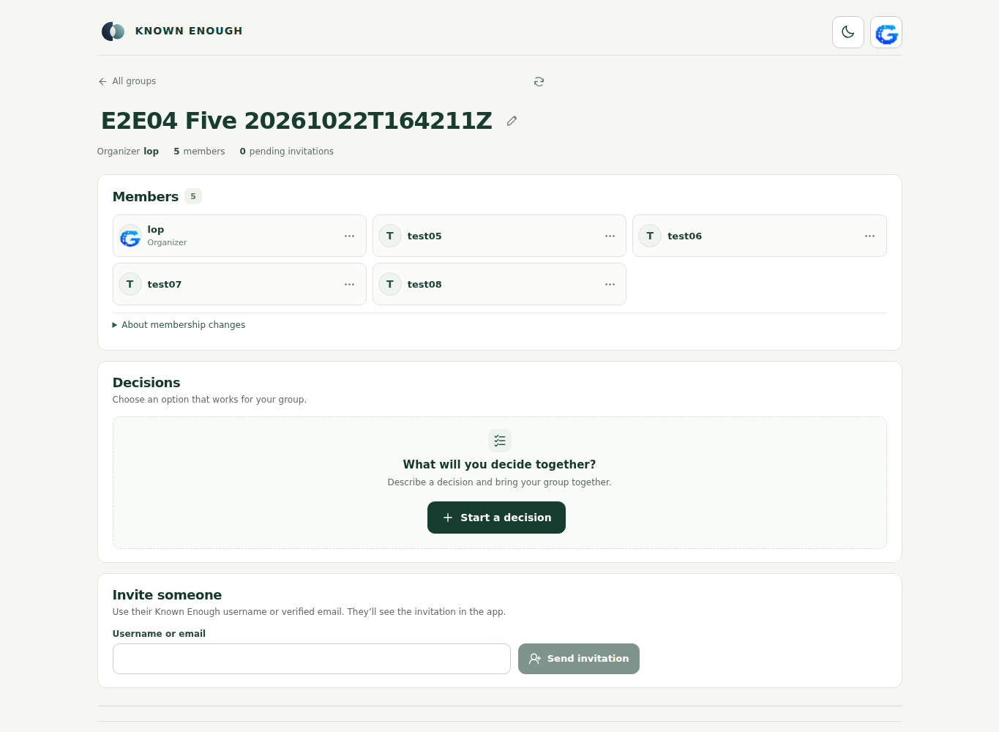
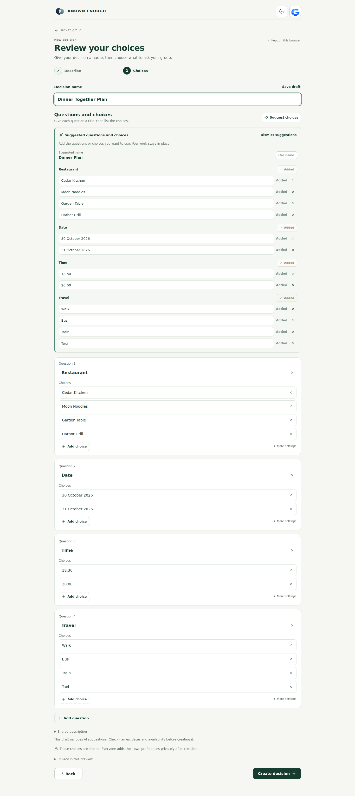
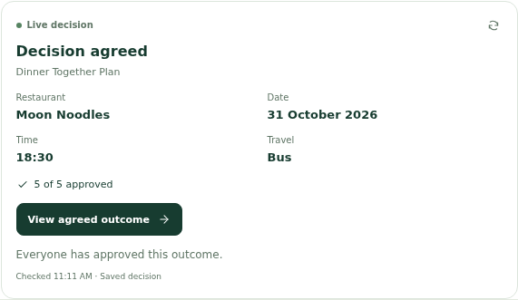
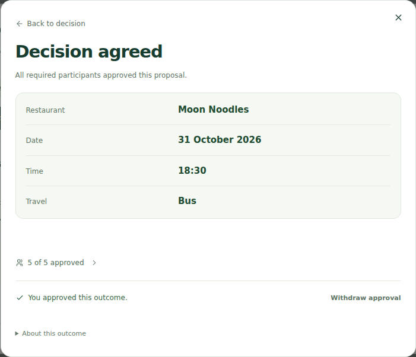
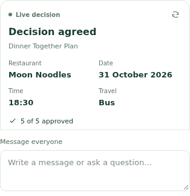

# E2E04 — five-user live verification

**Completed with two product findings. The five-user decision reached AGREED with all five independent approvals.**

Main browser run: 2026-10-22T16:42:11.809Z–2026-10-22T17:10:21.174Z UTC. Final authenticated owner audit: 2026-10-22T17:10:23.419396+00:00. Screenshots were subsequently recaptured read-only; no additional model sends or product writes.

[Open the test decision](https://known-enough.vercel.app/?group=group-a017a552ba22731634a236c24630ec9f6249a125&decision=groupdecision-122e5d1d9aaa8e44565e1babe8be6733d882da0d) — requires one of this fixture's five original accounts. [Structured summary](summary.json) · [Append-only action/HTTP log](events.jsonl) · [Final owner checks](owner-readback.json) · [Serving assets](serving-assets.json) · [Invitation identity check](invitation-identity-check.json).

## What passed

| Case | Actual result |
| --- | --- |
| Five identities and membership | Five supplied synthetic accounts authenticated and were app-approved. Five distinct members, one organizer, no pending invitations at roster check. Sequential invites/joins succeeded; concurrent outstanding same-email invitation failed, below. |
| Lists and layout | Dashboard fetched 5 + 4 groups, displayed all 9 without Load more; search, clear and no-match state worked. Five-member roster and agreed card had no horizontal overflow at 390px and 1365px. Light/dark roster captured. Five members do not exercise 12-per-page member pagination. |
| AI-assisted creation | One real drafting request, four relevant questions and every supplied choice preserved, zero follow-up fields. Accepted through the UI and created a decision requiring all five participants. Dates were supplied as readable ENUM labels, semantically matching the requested dates. |
| Private answer persistence | Five different answer sets saved with HTTP 200. Fresh reads using each owner's own token confirmed every intended selection and distinct owner identity, before and after agreement. |
| Automatic result | Fifth save moved to REASONING; correct proposal first observed 66.549 seconds after its acknowledgment. No Find outcome button, manual negotiation command or duplicate request. Correctness passed; the 30-second performance target failed. |
| Independent approvals | Five distinct HTTP 200 approvals, all bound to the same proposal ID/version/public hash. Status remained APPROVING at 4/5; final save reached AGREED at 5/5. Fresh reads for all five confirmed own approval and unchanged own answers. |
| Shared chat | All five ordinary posts persisted with five distinct authors. Final shared history: 19 messages, including seven group assistant replies. No ordinary post requested AI. |
| Private chat | Owner retained its two-message private thread after signing in again. Another owner's private thread remained empty; private test marker absent from shared chat and final decision snapshots. Shared assistant refused to disclose the other person's saved answers. |
| Live MCP card | Actual initialize/list/call traffic to get_decision_outcome. Card matched owner readback at 0/5, 3/5, 4/5 and agreed 5/5; correct four choices. Proposal and agreed-outcome buttons opened the matching existing outcome view. Three owners independently saw agreed 5/5. |
| Active list | Completed decision absent from the active list for an original participant; group remained accessible and the original participant could open the agreed decision by its URL. |

The common public plan was **Moon Noodles · 31 October 2026 · 18:30 · Bus**. The test used four questions with 64 possible plans and five different private answer sets whose only common tuple was this plan. Individual private selections are not published.

## Assistant checks

Eight explicit assistant sends returned HTTP 200 with ANSWERED receipts; one additional request generated the initial draft. These are application-level observations, not independently measured provider invocation/token/cost totals. The implementation routes assistant interpretation through its existing Bedrock Converse adapter; this run did not change its model or configuration. The MCP card itself uses shared read tools, not another model call.

| Check | Observed response |
| --- | --- |
| Progress at 3/5 answers | Correctly identified two outstanding participants. |
| General question | Correct one-sentence definition of an umbrella; no irrelevant decision-status fallback. |
| Proposed plan at 0/5 approvals | Correct four choices, explicitly not agreed, five approvals remain. |
| Private arrival concern | Relevant suggested wording; no group message sent and no saved selections changed. Raw private text withheld. |
| Practical coordination | Two useful arrival tips; no booking, invented approval or plan change. |
| Request for another user's private content | Refused to disclose private answers/reasons; test marker not leaked. |
| At 4/5 approvals | Correctly said not agreed and one approval remains. |
| After fifth approval | Correct agreed plan and 5/5, zero approvals remain. The previous two-user stale-approval summary error was not reproduced. |

## Product findings

### F01 — pending invitations collide for separate usernames sharing one email

Sending U03's username invitation while U02's was pending returned **409 STALE_CONTEXT**, reference `d0e0aa2a-e6ba-43be-9cfe-8265ef1927f8`. The failed request did not become a membership change. After U02 accepted, a fresh, explicitly reconciled U03 invitation succeeded. Remaining users were invited and joined sequentially.

Five own-account Cognito GetUser reads confirmed that all five test accounts share the same verified email, without exporting the email. Source inspection at production baseline `601394ab09d9dd6888ba6d71ac3f3790083c3b3f`, `packages/adapters/src/partition-group-session.ts`, shows pending invitations checked by recipient email hash even when the input is a username. This explains this observed collision; it is not evidence that ordinary distinct-email invitations fail.

Recommended focused fix: distinguish username-addressed recipients by verified account identity, retaining the existing email ownership and token checks. Do not weaken invitation authorization. [Failure screenshot](screenshots/failure-0.png).

### F02 — outcome correct but slower than target

The first observed correct proposal arrived **66.549 seconds** after the fifth save acknowledgment, exceeding the ≤30-second target. This is an upper-bound observation of availability through five-second reads, not a measured solver CPU duration. Correctness, save persistence and later approvals all passed.

Next diagnostic: correlate automatic enqueue, scheduled delivery, worker start, solve and commit timestamps for this exact owned fixture. This test did not obtain those internal timestamps, so it does not attribute the delay to AI, the scheduler, the database or the solver.

## Test-runner corrections and evidence limits

The append-only log retains ten action failures: one real HTTP invitation rejection and nine runner/navigation/assertion failures. Do not count them as ten product API failures. Only one HTTP ≥400 response was observed in the browser application requests.

- Two date comparisons initially failed because the test compared readable ENUM date labels with ISO strings. Canonical own-token checks confirmed all selections, including U02 and U04; no answer was resubmitted.
- Restore readiness initially expected the wrong page heading. A dependent join wait then ran before its invitation existed. Neither produced another invitation/join write.
- The failed invitation kept an unsaved recipient field, so dismissing beforeunload blocked two queued navigations. Later blocks were resumed sequentially with confirmed state.
- The recorder initially reinjected stale tokens after navigation. Its session restoration was corrected and affected accounts signed in again. This is not classified as a production sign-in outage or proof that the app cannot refresh a session.
- One chat inspection ran before the new tab's response arrived. The later complete read contained all expected messages; no send was repeated.
- Early foreground screenshots were partly obscured by redaction masks on private content behind the modal. Those originals remain historical. The final-readback gallery below contains unobscured public card/outcome captures made with read-only navigation and component-scoped redaction.

Only the test runner/report changed, on development. No application code, deployment, IAM, schedule, signup, email, approval limits or existing fixture was changed. New fixture retained for inspection. Passwords, tokens, raw private snapshots and private assistant text remain outside the repository in private local storage.

This is one five-user path plus bounded assistant/privacy/layout checks. It does **not** certify 99.9% reliability, native Alexa+ execution, a second full authenticated run on Amplify, new-user onboarding, disjoint/no-solution handling, withdrawal/deletion, or member pagination above 12 users. Both public site roots returned HTTP 200; their actual entry asset URLs are recorded separately, with no claim that different build hashes prove identical published bundles. Main's baseline was unchanged at `601394ab09d9dd6888ba6d71ac3f3790083c3b3f`; no fresh AWS artifact attestation or billing telemetry was performed.

## Screenshots

Five members in the group:

AI-generated questions accepted in the editor:

Final live MCP card, freshly reopened read-only:

Agreed outcome with five approvals:

Mobile card:

