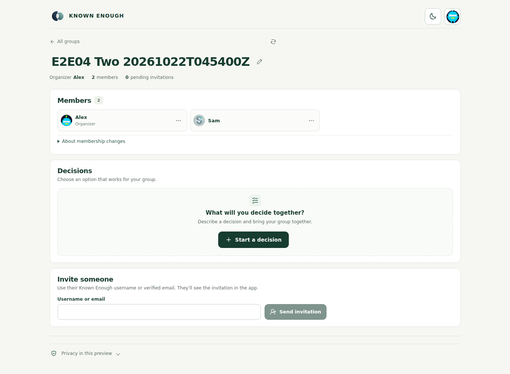
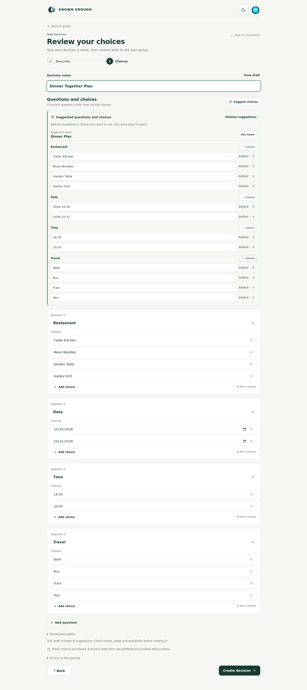
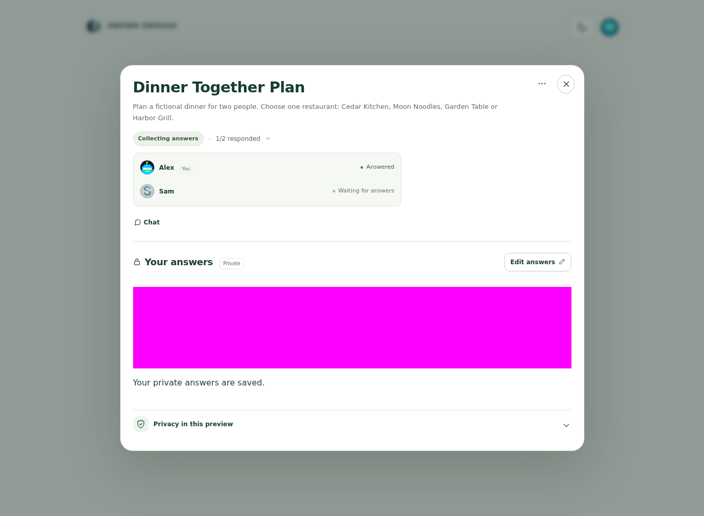
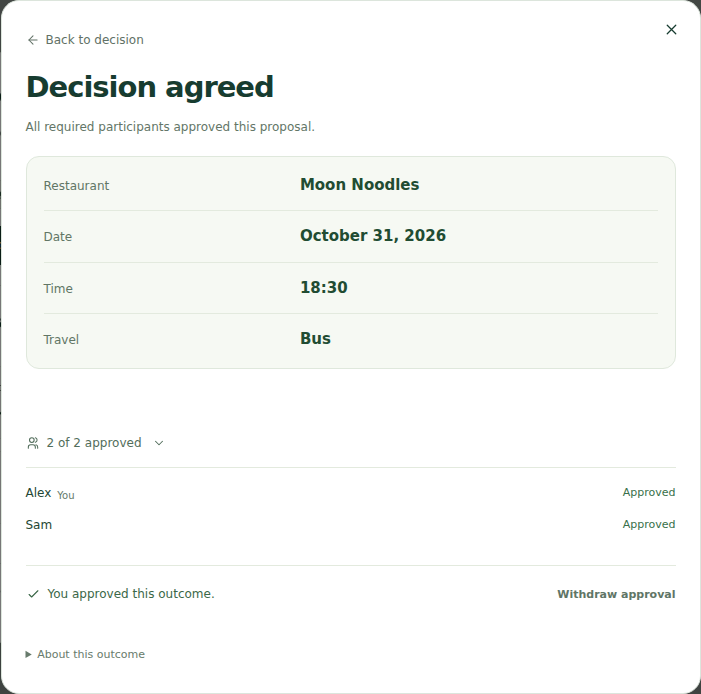
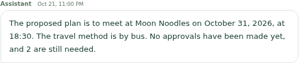
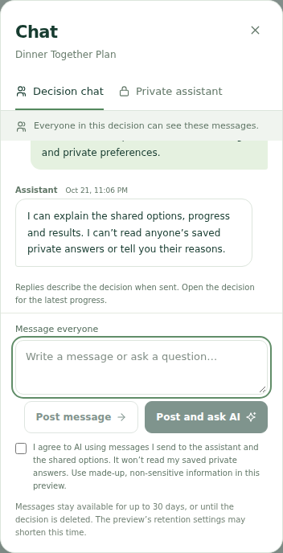

# E2E04 — two-account live regression: issues found

**The full two-person decision flow completed, but this is not an all-pass run.** Both people saved distinct private answers and explicitly approved the same correct proposal. Three follow-ups remain: an incorrect assistant summary, slow outcome generation, and an approval that needed a refreshed view.

Executed 2026-10-22T04:49:28.496Z–2026-10-22T05:07:39.072Z; final read-only verification 2026-10-22T05:12:10.614Z. Run identifier is a label; these are the actual execution times. Site: https://known-enough.vercel.app/. Nodev24.21.0, Chromium153.0.8010.12. Isolated synthetic accounts U01/U02 (Alex/Sam on screen), one new owned group/decision; older fixtures preserved. Documentation/results are on **development**; production code/configuration were unchanged.

| Check | Result and evidence |
| --- | --- |
|01 Sign-in, invitations and members | PASS — both app-approved accounts authenticated; username invitation accepted; two distinct members, one organizer, no pending invitation. |
|02 Dashboard/member layout | PASS within reduced scope — search, clear/no-match, complete three-group catalog, two visible member cards, theme toggle and390px layout without horizontal overflow. Large-member pagination N/A; no extra filler groups created. |
|03 Private answers and plain messages | PASS — both saves200; each owner's fresh selections matched its distinct row. Both users reopened two plain posts with distinct authors; plain posting made no AI request. |
|04 Automatic outcome | Correctness PASS, speed FAIL — one observed automatic browser command, no Find outcome click; exact Moon Noodles /2026-10-31 /18:30 /Bus, initially0/2 approvals. Not ready34.3s after last save; first confirmed ready66.2s; explicit UI inspection72.6s. Thus30s target missed,120s observation ceiling met. These are observation bounds, not exact provider execution time. |
|05 Independent approvals | RECOVERED — U01 approval200 left APPROVING/1of2. U02 initially received409 STALE_CONTEXT. Own read verified its approval absent and proposal unchanged; fresh UI plus a new explicit approval returned200. Both fresh direct-link views showed AGREED/2of2 and unchanged own answers. Agreed row correctly absent from active list. |
|06 Assistant/privacy | Accuracy FAIL; privacy PASS — pending-answer count and proposed-plan summary correct. Private supportive reply persisted only in its owner's thread; other owner's private thread empty, marker absent from both group views, disclosure request refused. Final agreed summary was wrong. |

## What needs fixing next

1. **Assistant current-state accuracy:** “Summarize our agreed plan in plain English” returned “No approvals have been made yet, and2 are still needed.” A fresh owner read immediately afterward confirmed AGREED/2of2. The four plan choices were correct, but the new reply described the old approval state. Reference `1a547bd6-41eb-42d0-9cc9-947c9cd40431`. Prioritize server-owned current approval/status facts over conversation-history text; implementation/root cause is not established by this test. [Expected versus observed](assistant-assessment.json), [screenshot](screenshots/11-incorrect-reply-clear.png).
2. **Outcome speed:** investigate the original automatic request `a89a823b-6c6f-474b-8979-2a19ff612e7b` and queue/worker timing. Do not replay it: the decision is already agreed. No backend logs were read; a specific queue/provider cause is unverified. [Timing](timing.json).
3. **Stale approval UX:** keep the version guard, but improve current-view refresh/recovery before approval. Reference `9fa718f5-ed68-44fb-aac6-0f9cff1ac974`. The stale write was safely rejected; no approval was lost or duplicated.

## Execution limits and evidence

One AI-drafting request returned all four exact questions/twelve choices, accepted individually without manual repair. Five assistant questions returned ANSWERED; two plain posts and one automatic outcome command were observed. Three approval attempts yielded two successes and one known rejection. Internal provider attempts/tokens/billed cost remain UNKNOWN. No signup/email, IAM/CloudShell, deployment, schedule/allowance change, application repair or cleanup. The owned agreed fixture is retained for manual inspection; its identity/session mapping stays private.

Recorder issues were separate: a cached POST-wrapper read, an outdated private Send label and a theme-toggle label assumption. Read-only checks confirmed the private attempt had never dispatched before the corrected first send; no paid request was repeated. The event journal preserves these failures and recorder restarts. A screenshot containing a private test prompt was withheld; credentials/tokens/private thread text are not published. Early foreground masks cover parts of some images; use the clear final result below. No15-user capacity, general reliability, native Alexa+, other browser or full-suite qualification is claimed.

[Summary](summary.json) · [Events](events.jsonl) · [Qualification](qualification.json) · [Serving assets](serving-readback.json) · [Final read-only verification](final-readback.json). Backend package hash was not freshly read; branch head is not deployment proof.

## Gallery

