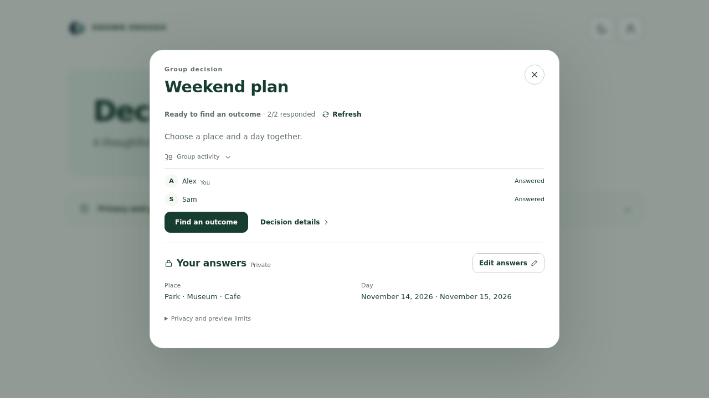
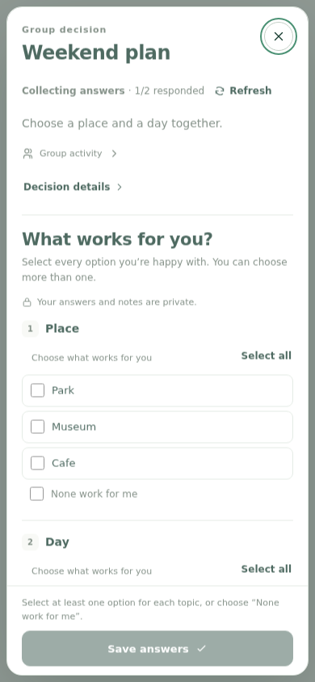
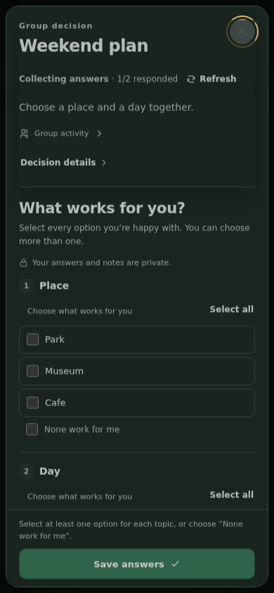

# Compact decision details

Frontend-only continuation of FF06. Published from `f0c436ccdfe5773ea74a3ca86d9cd0371ac1588e`, Amplify127, [successful release](https://github.com/Known-Enough/known-enough/actions/runs/39171843902). All seven public file/hash readbacks match; API/configuration unchanged, no data/provider actions. [Receipt](publication.json). User live acceptance pending.

- One status line includes the public responded count. Missing progress is shown as a participant count, never a fabricated completion count.
- Borderless expandable Group activity shows names and public response/approval status, without anyone else’s private choices.
- Acknowledged owner answers collapse into a topic summary with Edit answers. Unconfirmed AI suggestions stay separate; saved None and legacy conditions are not presented as unrestricted choices.
- Editing retains checkbox options, optional favorites, explicit None, consent, notes review and exact command payloads. Short topics use two columns on wide screens; phones use one. Cancel editing preserves saved answers without a write.
- Save collapses only after command acknowledgement and refreshed owner state. Unknown writes retain editing/recovery and never trigger automatic retries. Same-frame refresh preserves unsaved options. Finished decisions are read-only.
- Save answers is primary while editing; Find an outcome / View proposal / View outcome follow existing state and permissions. Final approval remains explicit.

## Validation

8 controlled browser checks, 6 focused unit checks and 1 hosted-preview check pass. Type, lint/boundary, build/bundle, reference, planning and whitespace checks pass. Desktop saved-summary and phone light/dark screenshots were inspected.

The full project check was attempted: 1,634 passed, 31 failed, 2 skipped, one unhandled error. All remaining failure groups occur in the previously recorded baseline comparison; the obsolete decision UI expectation was updated for the new collapsed summary and passes. This is not a full-suite or live qualification PASS. See [validation](validation.json) for exact groups and limits.

No API, worker, schedule, IAM, schema, data or provider changes. Existing native API and automatic group membership remain in place.

