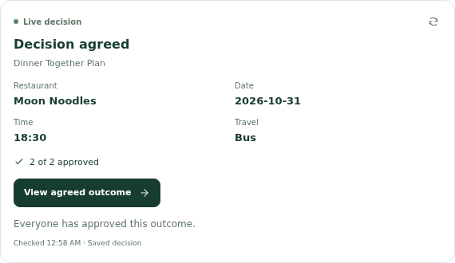
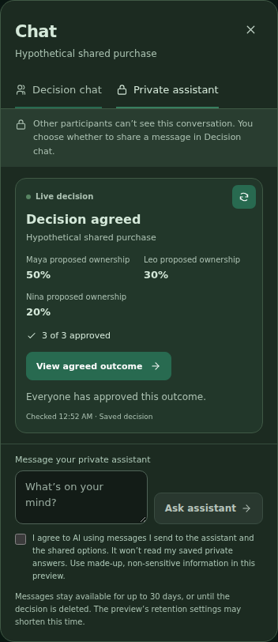

# Live decision card

Published to Vercel and Amplify from `601394ab09d9dd6888ba6d71ac3f3790083c3b3f`. [Publication run](https://github.com/Known-Enough/known-enough/actions/runs/39737129347).

The card is inside Decision chat and Private assistant. It calls the actual MCP `get_decision_outcome` tool and displays the current public choices, status and approval count. Its short explanation comes from saved state; historical chat text is not treated as current authority. Refresh runs after message receipts, on focus/return online, manually and every 20 seconds while visible.

Wrong-decision, malformed and denied reads clear previous values. Viewing the outcome refreshes the decision and opens its existing modal without approving anything. Unsaved decision edits and pending actions block that navigation. Private answers are not read by this tool or copied into chat.

## Verification

Five unit cases and five mocked browser cases passed, including a stale historical reply alongside a fresh agreement, changed approvals, retired outcomes, denied/wrong-resource responses, immediate refresh after a reply, mobile dark layout and outcome navigation with zero approval writes. Type checking, lint/dependency boundaries (662 references), production build and whitespace passed. Full suite not run. An initial mock omitted the server's expected GET405 response; that fixture was corrected before the final browser pass.

The live Vercel check used an existing approved synthetic participant and an already agreed decision. Actual MCP initialization, discovery and tool call completed; four choices and 2/2 approvals matched a fresh public read. No new messages or model calls were requested. All ten Amplify public files returned200 and matched the release hashes. Application configuration matched, with zero configuration/data writes.

The first Amplify attempt stopped before writes because its default API hash was older than the installed runtime. The observed hash matched the prior native API publication receipt; supplying that checked hash preserved the original guard and completed publication. No backend replacement or permission repair was required.

General model-generated prose and older chat replies remain unchanged; the card provides separate current facts. Completed-decision history and calendar export remain outside this change.

[Machine-readable receipt](publication.json)

