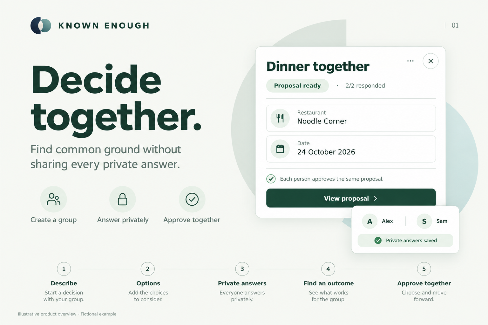
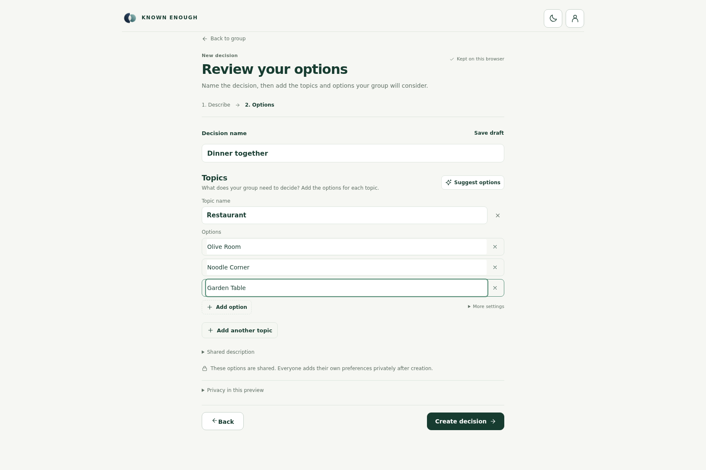
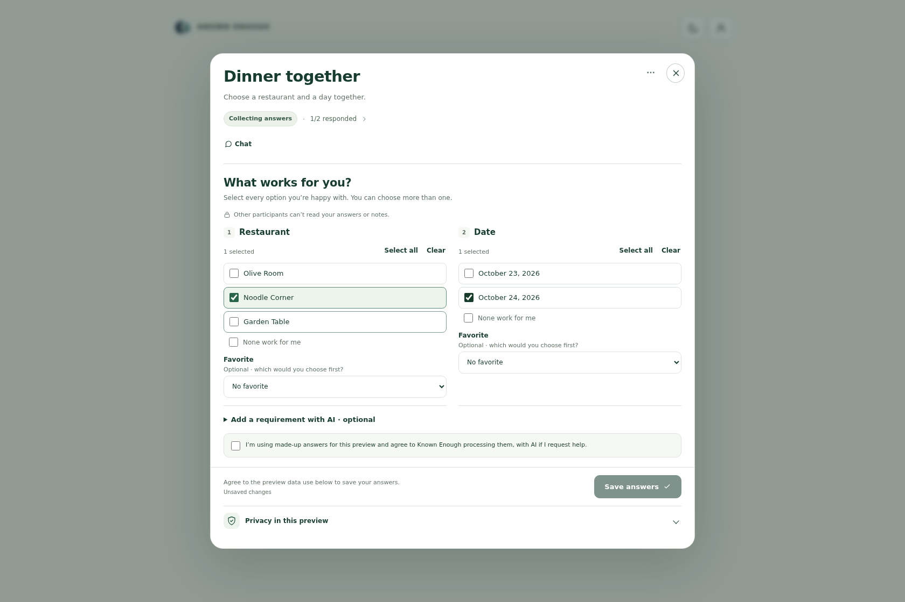
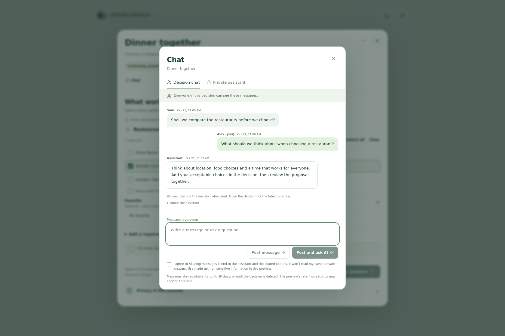
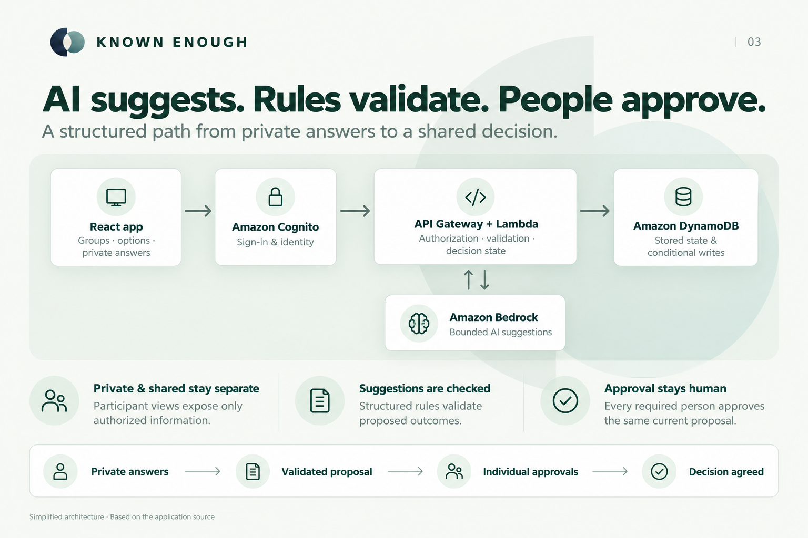
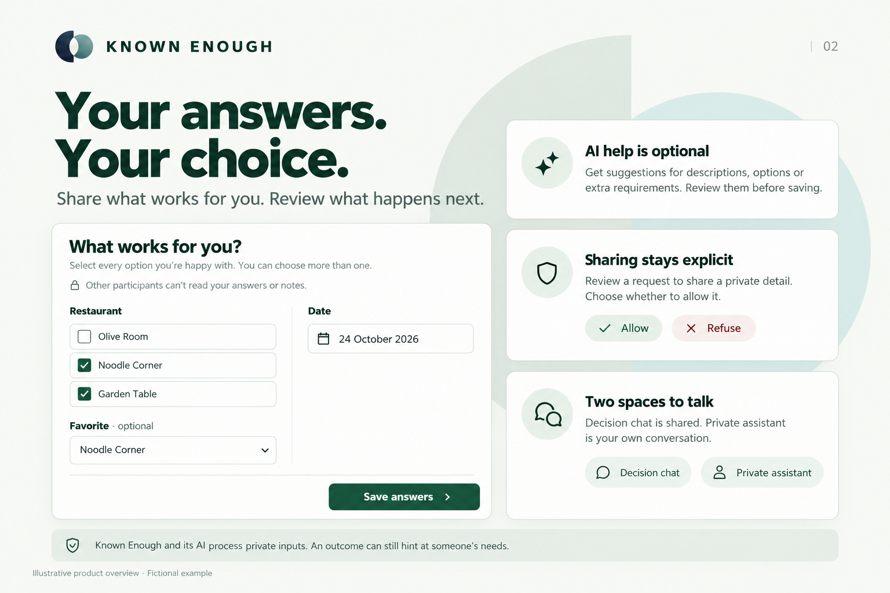

## Inspiration

Choosing dinner with friends sounds simple. In practice, one person has a firm budget, another needs a quieter place, and someone else can only make one date. A group chat often makes people explain their circumstances before the group can make progress.

We started with a question: **could people find a choice that works for everyone without publishing every private answer?**

Known Enough turns that question into a decision workflow. People share the choices they are considering, privately say what works for them, and review a concrete proposal. Agreement still belongs to the people making it.

*The idea in one view: private answers become a proposal people review together. Illustrative overview with fictional data.*

## What it does

Known Enough helps small groups make decisions about finite choices: a restaurant, a day, a destination, or a shared plan.

Imagine Alex accepts Olive Room or Noodle Corner, while Sam accepts Noodle Corner or Garden Table. Both can make 24 October. The app can propose **Noodle Corner on 24 October** without showing either person's complete answers to the other. It becomes an agreement only after both approve that exact proposal.

### Start with the shared choices

Create a group, invite participants, and describe the shared goal. Add topics and alternatives manually, or request optional AI suggestions and choose which ones to use. The organizer defines the choices; each participant adds their own preferences later.

*Define what the group is choosing before asking what works for each person. Actual interface rendered locally with fictional data.*

### Save what works for you

Each person privately selects acceptable options and can name a favorite. Optional private notes can become extra requirements after review. Saving answers records what works for that person; approval of a particular proposal comes later.

*People can accept several options without sharing their complete answers with the group. Actual interface rendered locally with fictional data.*

### Review and approve the same proposal

Once the required usable answers are saved, background processing looks for an outcome. Server rules check candidates against confirmed requirements and applicable permissions. Each required participant then reviews the same current proposal from their own account. A proposal is not an agreement until all required approvals are recorded.

When a compromise needs a participant's permission, the person decides whether to allow the adjustment. Permission to share a detail and approval of the final proposal are separate choices.

**Decision chat** gives the group a shared conversation. **Private assistant** gives each participant a separate space to think. A private message reaches Decision chat only after a preview and an explicit post.

## How we built it

### A conversational assistant with clear limits

We built for the **Alexa+ web-simulation track**, with our own browser experience and a self-hosted MCP server. Native Alexa+ devices and gated developer tools are not connected.

*The conversation supports the decision rather than replacing it. Actual component with fictional local messages; this capture does not demonstrate a live model response.*

The MCP implementation uses the official TypeScript SDK, Streamable HTTP, and protocol version **2025-11-25**. It exposes four read-only tools:

- `list_groups`
- `list_group_decisions`
- `get_decision_progress`
- `get_decision_outcome`

Each tool reuses the application's authenticated access checks and returns a restricted shared view. Tools cannot fetch private answers, change answers, grant permission, or approve for a participant.

The browser chat uses application chat routes and Amazon Bedrock. Its **About the assistant** panel initializes an MCP client and discovers available tools; ordinary chat messages do not each execute an MCP tool. This distinction keeps the actual integration visible and testable.

### AI suggestions, checked application state

The frontend uses **React, Vite, and TypeScript**. Shared **Zod** schemas validate the data moving between the interface, API, and decision logic.

**Amazon Bedrock Converse with Amazon Nova Lite** supports option suggestions, private-note interpretation, candidate selection, and conversational assistance. We use bounded role-specific inputs and validate structured outputs before they affect application state. AI may suggest an outcome; it cannot finalize agreement.

The AWS backend combines:

- **Amazon Cognito** for identity, with application admission and group membership checked separately.
- **API Gateway and AWS Lambda** for authenticated application and MCP requests.
- **Amazon DynamoDB** for decision state, private inputs, permissions, approvals, chat, and durable jobs, with conditional writes protecting version-sensitive updates.
- **Amazon EventBridge and a Lambda worker** so outcome processing can continue after the initiating browser request ends.

Vercel hosts the primary frontend. Amplify Hosting also supported the hosted frontend during development. S3 stores private release/recovery artifacts, and CloudWatch provides bounded operational diagnostics.

*AI suggests, application rules validate, and people approve. This simplified architecture shows Bedrock assisting the backend without granting it approval authority.*

### Privacy expressed through behavior

Other participants do not receive someone's private answers simply because they share a group. The service stores and processes those answers, and permitted AI features send relevant inputs to Bedrock. An outcome can still suggest something about a person's needs.

Chat has a narrower context: recent messages in the sender's conversation and shared choices, excluding saved private answers and other participants' private threads. Sharing a private chat message requires a separate explicit action.

*Privacy is expressed through specific choices: saving answers, requesting AI help, and allowing a disclosure are separate actions. Illustrative product overview.*

## Challenges we ran into

**Making approval precise.** Saving acceptable choices is different from approving an outcome. We tied approval to the current proposal so an earlier approval cannot silently authorize a changed result.

**Keeping AI inside the workflow.** Useful language is not enough to establish valid state. We had to validate returned choices, requirements, permission dependencies, and proposal versions independently. Nova Lite's structured-output constraints also required compatible forced-tool schemas and strict application-side decoding.

**Handling independent participants and unreliable networks.** People save at different times. A request can succeed while its acknowledgment disappears. Version checks, idempotency, durable receipts, and explicit unknown states help avoid duplicate operations and misleading success messages.

**Keeping the experience understandable.** We separated “these choices work for me,” “you may share this,” and “I approve this proposal,” then kept the interface focused on the next relevant action.

## Accomplishments that we're proud of

The strongest result is a complete path from private answers to individually approved agreement, with a conversational layer that respects the same boundaries.

A **dated qualification on 20 October 2026** exercised fifteen separate test identities. Its recorded evidence includes individual answer saves, a shared proposed outcome, a state with **14 of 15 approvals that remained unagreed**, and a final **15 of 15 agreed outcome**. It also records shared-chat persistence and private-thread isolation. The report combines an executed run and targeted follow-up; it is not a fresh full-suite result or a general reliability benchmark.

*The last required approval changes the result to Decision agreed. Preserved application capture from the 20 October qualification with fifteen fictional test accounts.*

The repository contains unit, integration, browser, schema, and architectural checks. We preserve the dates and limitations of recorded results instead of treating the existence of tests as proof that every case passes.

[Read the qualification evidence](https://github.com/Known-Enough/known-enough/blob/development/docs/review-artifacts/E2E04/20261020T162508Z/report.md).

## What we learned

Privacy needs explicit read models and authorization checks. A hidden field alone is not a privacy boundary.

Consent needs context: who granted it, what it permits, and which decision or proposal it applies to.

Conversational interfaces work best when their claims about status and approvals come from saved application state. A persuasive reply must never substitute for a participant's decision.

AI-assisted development helped us implement and investigate changes quickly, while type checks, targeted tests, and review exposed assumptions that fluent generated code could conceal.

## What's next for Known Enough

We want to improve explanations when no shared option works, make judge and participant onboarding smoother, and broaden accessibility and evaluation coverage. Native Alexa+ integration is a future direction if access becomes available.

The current preview supports finite choices and groups of up to sixteen members. It does not verify real-world prices or availability, make bookings, or claim end-to-end encryption. Use fictional, non-sensitive information when trying the preview.

**Known Enough is built around a practical idea: people can decide together while keeping control of the answers they share.**
